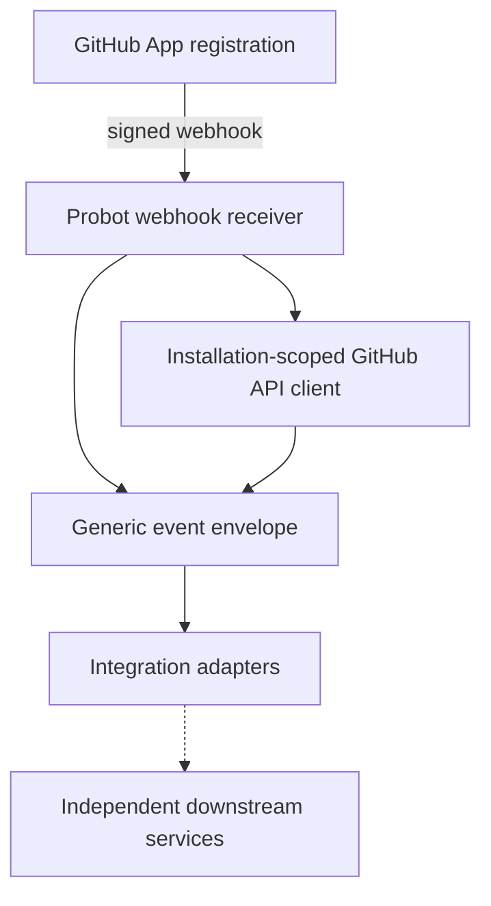

# Device Mobility GitHub App

Independent GitHub App integration service, built with **TypeScript, Node.js and Probot**. This repository owns GitHub installation authentication, webhook event handling, and generic integration routing. It does **not** sign APKs, own signing keys, or publish artifacts.

## Architecture



An installed GitHub App sends signed webhooks to Probot. The handler identifies completed workflow runs, logs a generic envelope, and can query GitHub metadata using the installation-scoped Octokit client. No downstream service is invoked in this initial scaffold. Consumers must independently authorize incoming requests and validate artifacts.

**Live status (Phase 5, 2026-10-31):** a real signed `workflow_run.completed` webhook was delivered by GitHub through a Cloudflare Quick Tunnel to Probot running on a MacBook and processed successfully (HTTP 200), including a successful redelivery. See `docs/VALIDATION.md` for delivery IDs, run correlation, and the one known limitation (the test repo's self-hosted build runner was offline, so the webhook path is proven but the APK build itself did not execute).

## Getting started

Use Node.js 22 or newer and npm. Run `npm install`, `npm run typecheck`, `npm test`, `npm run build`, then `npm start`. Copy `.env.example` to `.env` and set `APP_ID`, `PRIVATE_KEY` and `WEBHOOK_SECRET` with values from your own GitHub App registration. Never commit credentials.

Configure the GitHub App with read-only **Actions** and **Metadata** repository permissions; subscribe to `workflow_run` and `installation` events, and select only your POC repositories. The versioned reference configuration is in `config/app-manifest.json`. Creating a manifest does not automatically register or update an App.

To receive real webhook events on a local machine, GitHub must be able to deliver them via a reachable endpoint or a developer relay such as Smee; Probot does not automatically eliminate inbound delivery requirements. For authentication/API-only operation, webhooks need not be enabled.

## Boundaries

- This app remains generic; no Android, APK, signing, or Artifactory-specific logic.
- No webhook-driven signing or publishing is enabled by the scaffold.
- The GitHub App is a GitHub-registered identity, not a signing service.
- Runtime credentials and registration/installation must be provided by the operator.
- This repository intentionally has no GitHub Actions workflow.

## References

- https://docs.github.com/en/apps/creating-github-apps/writing-code-for-a-github-app/quickstart
- https://probot.github.io/docs/
- https://medium.com/@JoshuaTheMiller/go-go-github-apps-d1b4bb26812b

## API-first operation (no webhook required)

A separate **read-only Octokit CLI** now supports App/installation authentication and GitHub API metadata lookup without a running Probot server, Cloudflare Tunnel, webhook secret, or public domain.

```bash
npm install
npm run build
export APP_ID=5554493
export PRIVATE_KEY_PATH=/absolute/path/to/app-private-key.pem
npm run cli -- installations
npm run cli -- repos --installation 177191086
npm run cli -- runs --installation 177191086 --repo erikg84/apk-signing-poc-app
npm run cli -- artifacts --installation 177191086 --repo erikg84/apk-signing-poc-app --run 41212205303
```

The existing Probot webhook handler remains optional; it is not involved in these commands. For the full contract see [API-first operation](docs/API_FIRST.md). Authentication requires local private-key access, so the CLI cannot be exercised with credentials from GitHub Actions. The Python signing service remains independent and unchanged.

---

## API-first integration checkpoint — 2026-10-31

The current integration design and verified-versus-pending acceptance gates are in [API-first artifact handoff](docs/API_FIRST_HANDOFF.md). The generic GitHub App (`erikg84/deivice-mobility-github-app`) has passed real installation-scoped read-only API tests without a webhook or Cloudflare. The Python signing service remains independent and retains artifact/provenance/signing/publication responsibility. The dummy app's most recent run `41212205303` was **cancelled with no artifact**, so no new cross-repository handoff or signing test is claimed. Previous POC signing receipts remain historical evidence, not proof of this new API-first integration. Webhook-specific instructions above describe an **optional legacy/event-driven path**, not a prerequisite for API-first usage.

## API-first verified artifact checkpoint — 2026-10-31

A **real successful October 29 workflow artifact** has been located and downloaded: run `40799940323`, artifact `12865143006`. Its ZIP digest matches GitHub, and the enclosed unsigned APK digest matches both included checksum and metadata. See [artifact qualification evidence](docs/API_FIRST_ARTIFACT_QUALIFICATION_20261031.md). This resolves the **missing-artifact discovery** blocker, but does **not** prove a newly executed TypeScript CLI handoff, independent Android binary validation, additional signing, or JFrog publication.
