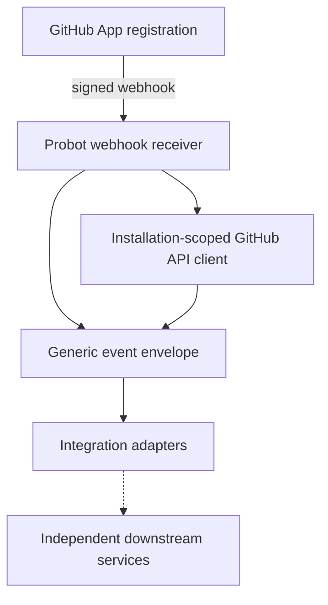

# Device Mobility GitHub App

Independent GitHub App integration service, built with **TypeScript, Node.js and Probot**. This repository owns GitHub installation authentication, webhook event handling, and generic integration routing. It does **not** sign APKs, own signing keys, or publish artifacts.

## Architecture

An installed GitHub App sends signed webhooks to Probot. The handler identifies completed workflow runs, logs a generic envelope, and can query GitHub metadata using the installation-scoped Octokit client. No downstream service is invoked in this initial scaffold. Consumers must independently authorize incoming requests and validate artifacts.

## Getting started

Use Node.js 22 or newer and npm. Run `npm install`, `npm run typecheck`, `npm test`, `npm run build`, then `npm start`. Copy `.env.example` to `.env` and set `APP_ID`, `PRIVATE_KEY` and `WEBHOOK_SECRET` with values from your own GitHub App registration. Never commit credentials.

Configure the GitHub App with read-only **Actions** and **Metadata** repository permissions; subscribe to `workflow_run` and `installation` events, and select only your POC repositories. The versioned reference configuration is in `config/app-manifest.json`. Creating a manifest does not automatically register or update an App.

To receive real webhook events on a local machine, GitHub must be able to deliver them via a reachable endpoint or a developer relay such as Smee; Probot does not automatically eliminate inbound delivery requirements. For authentication/API-only operation, webhooks need not be enabled.

## Boundaries

- This app remains generic; no Android, APK, signing, or Artifactory-specific logic.
- No webhook-driven signing or publishing is enabled by the scaffold.
- The GitHub App is a GitHub-registered identity, not a signing service.
- Runtime credentials and registration/installation must be provided by the operator.
- This repository intentionally has no GitHub Actions workflow.

## References

- https://docs.github.com/en/apps/creating-github-apps/writing-code-for-a-github-app/quickstart
- https://probot.github.io/docs/
- https://medium.com/@JoshuaTheMiller/go-go-github-apps-d1b4bb26812b
