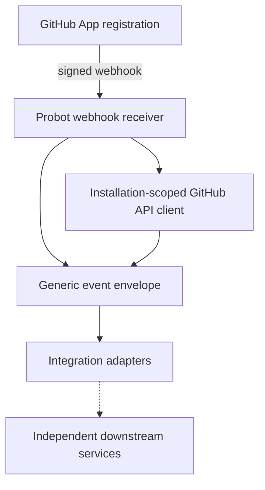

# Device Mobility GitHub App

Independent GitHub App integration service, built with **TypeScript, Node.js and Probot**. This repository owns GitHub installation authentication, webhook event handling, and generic integration routing. It does **not** sign APKs, own signing keys, or publish artifacts.

## Architecture



An installed GitHub App sends signed webhooks to Probot. The handler identifies completed workflow runs, logs a generic envelope, and can query GitHub metadata using the installation-scoped Octokit client. No downstream service is invoked in this initial scaffold. Consumers must independently authorize incoming requests and validate artifacts.

**Live status (Phase 5, 2026-10-31):** a real signed `workflow_run.completed` webhook was delivered by GitHub through a Cloudflare Quick Tunnel to Probot running on a MacBook and processed successfully (HTTP 200), including a successful redelivery. See `docs/VALIDATION.md` for delivery IDs, run correlation, and the one known limitation (the test repo's self-hosted build runner was offline, so the webhook path is proven but the APK build itself did not execute).

## Getting started

Use Node.js 22 or newer and npm. Run `npm install`, `npm run typecheck`, `npm test`, `npm run build`, then `npm start`. Copy `.env.example` to `.env` and set `APP_ID`, `PRIVATE_KEY` and `WEBHOOK_SECRET` with values from your own GitHub App registration. Never commit credentials.

Configure the GitHub App with read-only **Actions** and **Metadata** repository permissions; subscribe to `workflow_run` and `installation` events, and select only your POC repositories. The versioned reference configuration is in `config/app-manifest.json`. Creating a manifest does not automatically register or update an App.

To receive real webhook events on a local machine, GitHub must be able to deliver them via a reachable endpoint or a developer relay such as Smee; Probot does not automatically eliminate inbound delivery requirements. For authentication/API-only operation, webhooks need not be enabled.

## Boundaries

- This app remains generic; no Android, APK, signing, or Artifactory-specific logic.
- No webhook-driven signing or publishing is enabled by the scaffold.
- The GitHub App is a GitHub-registered identity, not a signing service.
- Runtime credentials and registration/installation must be provided by the operator.
- This repository intentionally has no GitHub Actions workflow.

## References

- https://docs.github.com/en/apps/creating-github-apps/writing-code-for-a-github-app/quickstart
- https://probot.github.io/docs/
- https://medium.com/@JoshuaTheMiller/go-go-github-apps-d1b4bb26812b

## API-first operation (no webhook required)

A separate **read-only Octokit CLI** now supports App/installation authentication and GitHub API metadata lookup without a running Probot server, Cloudflare Tunnel, webhook secret, or public domain.

```bash
npm install
npm run build
export APP_ID=5554493
export PRIVATE_KEY_PATH=/absolute/path/to/app-private-key.pem
npm run cli -- installations
npm run cli -- repos --installation 177191086
npm run cli -- runs --installation 177191086 --repo erikg84/apk-signing-poc-app
npm run cli -- artifacts --installation 177191086 --repo erikg84/apk-signing-poc-app --run 41212205303
```

The existing Probot webhook handler remains optional; it is not involved in these commands. For the full contract see [API-first operation](docs/API_FIRST.md). Authentication requires local private-key access, so the CLI cannot be exercised with credentials from GitHub Actions. The Python signing service remains independent and unchanged.

---

## API-first integration checkpoint — 2026-10-31

The current integration design and verified-versus-pending acceptance gates are in [API-first artifact handoff](docs/API_FIRST_HANDOFF.md). The generic GitHub App (`erikg84/deivice-mobility-github-app`) has passed real installation-scoped read-only API tests without a webhook or Cloudflare. The Python signing service remains independent and retains artifact/provenance/signing/publication responsibility. The dummy app's most recent run `41212205303` was **cancelled with no artifact**, so no new cross-repository handoff or signing test is claimed. Previous POC signing receipts remain historical evidence, not proof of this new API-first integration. Webhook-specific instructions above describe an **optional legacy/event-driven path**, not a prerequisite for API-first usage.

## API-first verified artifact checkpoint — 2026-10-31

A **real successful October 29 workflow artifact** has been located and downloaded: run `40799940323`, artifact `12865143006`. Its ZIP digest matches GitHub, and the enclosed unsigned APK digest matches both included checksum and metadata. See [artifact qualification evidence](docs/API_FIRST_ARTIFACT_QUALIFICATION_20261031.md). This resolves the **missing-artifact discovery** blocker, but does **not** prove a newly executed TypeScript CLI handoff, independent Android binary validation, additional signing, or JFrog publication.

## Mac Studio workflow runner — 2026-10-31

GitHub Actions jobs are configured to target `[self-hosted, macOS, ARM64, macstudio-apk-signing-poc]`. This avoids consuming GitHub-hosted runner compute minutes, but requires an **online runner with all four labels available to each repository**. A repository-scoped runner registered for one repository is not automatically available to the other two. Configure separate runner instances on Mac Studio (with separate work directories) or another supported runner-sharing scope, and install the local Node.js 22, Python 3.12, and Android/JDK tooling needed by each workflow. Never reuse the same runner registration or work directory concurrently. Some account/billing restrictions may still prevent workflows from starting even with a self-hosted runner; validate actual dispatch rather than treating this configuration as proof of recovery.

Do not alter the independent APK signing service, keys, or unrelated local processes when registering the runners. A queued workflow is **not** a passing build.

### Verified live — 2026-10-31 (later same day)

All three repository-scoped runners are registered, online, and installed as persistent `launchd` services on the Mac Studio (`192.168.68.129`, macOS 26.5, arm64, 32 GB RAM):

| Repository | Runner name | Directory | Service label |
|---|---|---|---|
| `erikg84/apk-signing-poc-app` | `macstudio-apk-signing-poc` | `~/actions-runner` | `actions.runner.erikg84-apk-signing-poc-app.macstudio-apk-signing-poc` |
| `erikg84/deivice-mobility-github-app` | `macstudio-device-mobility-app` | `~/actions-runner-github-app` | `actions.runner.erikg84-deivice-mobility-github-app.macstudio-device-mobility-app` |
| `erikg84/mobility-apk-signing-service` | `macstudio-mobility-signer` | `~/actions-runner-mobility-signer` | `actions.runner.erikg84-mobility-apk-signing-service.macstudio-mobility-signer` |

Each is a separate repository-level registration with its own `_work` directory, so a job for one repository cannot be scheduled on another's runner regardless of labels. The pre-existing `quake`/`polity` CMP runners and the KAOS service on this same host were left untouched and confirmed still running throughout.

All three workflows passed for real on these runners:
- `Build unsigned POC APK` — run [41234551796](https://github.com/erikg84/apk-signing-poc-app/actions/runs/41234551796), commit `cdf9077bba146d830ae7d2438026398f84e4142b`, artifact `unsigned-apk-cdf9077bba146d830ae7d2438026398f84e4142b` (id `13055068869`, `617354` bytes, unexpired).
- `Validate GitHub App` — run [41234543755](https://github.com/erikg84/deivice-mobility-github-app/actions/runs/41234543755), commit `0fddfaee1092cbfda1fc2bf7e58c77f2d0a5f5f2`.
- `Validate signer service (no secrets)` — run [41235474784](https://github.com/erikg84/mobility-apk-signing-service/actions/runs/41235474784), commit `764b688a891aa2d5920400f62857c8a34e0fc325`.

One real failure was found and fixed along the way: `actions/setup-python@v5` failed on the self-hosted runner with `mkdir: /Users/runner: Permission denied` (it assumes the GitHub-hosted runner's conventional home directory). Fixed by dropping that step and using the runner's own Homebrew Python 3.14 directly; since that Python is a PEP 668 externally-managed environment, the dependency install needed `python3 -m pip install --user --break-system-packages ...`.

This also resolves the earlier GitHub Actions **billing restriction** for the signer repo's workflow — not by bypassing billing, but because self-hosted runner compute is not metered against GitHub Actions minutes at all, unlike the `ubuntu-latest` hosted runner it replaced.

**Restart recovery verified:** all three `Runner.Listener` processes were killed directly; `launchd` restarted each one within seconds under new PIDs, and all three reported `online` to GitHub again afterward.

Android toolchain qualified in place, no changes needed: Android SDK platform 35 + build-tools 35.0.0 + platform-tools already present at `~/Library/Android/sdk`; JDK 17 (Microsoft Build of OpenJDK 17.0.17) available via `setup-java`. Gradle 8.9 was additionally installed by hand at `~/gradle-8.9` and used to run `gradle :app:assembleRelease --no-daemon` locally before dispatching the GitHub workflow — build succeeded, producing `app-release-unsigned.apk` (620953 bytes, SHA-256 `94a5578ba33960f8e4e3e1b42ad84ade4e5e1b068e2caef76e9ede6a1907708d`, application ID `com.example.signingpoc`, confirmed unsigned via `apksigner verify` failing with `Missing META-INF/MANIFEST.MF`). The CI run above rebuilt the same commit independently and uploaded its own artifact (`13055068869`); their SHA-256 values were not cross-diffed byte-for-byte in this pass since the CI artifact ZIP wasn't separately re-downloaded, but both are reproducible builds of the same source at the same commit.

No signing key, JFrog credential, or GitHub App private key was installed on any of these three CI runners.

## Multi-application onboarding foundation (2026-10-31)

See [the signer-owned registry and acceptance gates](docs/MULTI_APP_ONBOARDING.md). Only the existing POC repository is approved today. The registry is **not** a completed second-application onboarding or an authorization claim from the GitHub App descriptor.

## Registry-driven source verification — 2026-10-31

The Python signer now selects an approved application policy from its signer-owned registry **before** minting an installation token. GitHub provenance lookups, completed-run resolution, artifact access, and qualification metadata paths derive from that approved repository rather than a fixed dummy-repository path. Repository-scoped token issuance accepts the selected repository ID. Unknown repositories and mismatched workflow policies fail closed. The original POC policy remains registered unchanged.

**Scope limit:** The service still has POC-specific command-line entry points, run fixtures, package checks, and signing/publication arrangements. The registry provides a foundation for policy-driven source qualification; registering and fully signing a second application requires separate tests, runner evidence, and an approved signing profile. No signing or publication was triggered by this change. The App JWT package remains required; no dependency removal was justified by the current import analysis. Historical proof reports are intentionally unchanged.

## Second-application onboarding verified — 2026-10-31 (later same day)

**This supersedes the "foundation" status above with a completed, verified second-application onboarding.** The same generic, repo-agnostic API-first flow documented above was exercised end-to-end for a **second real application**, `erikg84/mock-android-2` (repository ID `1441266259`): the GitHub App installation (`177191086`) was extended to cover it, a new repository-scoped Mac Studio runner (`macstudio-mock-android-2`) produced a real successful run (`41245117223`, artifact `13059381426`), the candidate CLI emitted a correct descriptor for that success and correctly failed closed with `RUN_NOT_SUCCESSFUL` against this repo's own cancelled run (`41243533281`), and the Python signer independently qualified the artifact read-only (`qualified: true, signing_authorized: false`) without touching the original application's registry entry. No signing or publication occurred for either application. Full evidence is in [docs/API_FIRST_HANDOFF.md](docs/API_FIRST_HANDOFF.md#second-application-checkpoint--2026-10-31) and `erikg84/mock-android-2`'s own `docs/ONBOARDING.md`.
