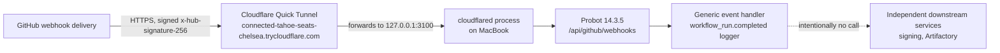
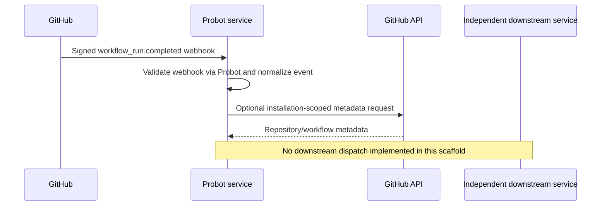
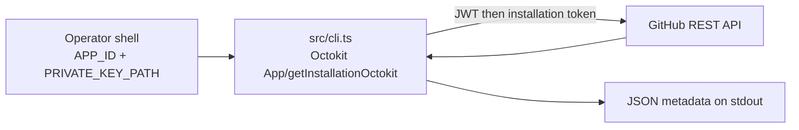

# Architecture

This repository contains only the GitHub App's integration code. GitHub owns App registration and installations; Probot receives signed webhook requests and supplies an installation-scoped Octokit client. Events are normalized into generic envelopes for future adapters.

## Live delivery path (verified Phase 5)

GitHub signs each delivery with the App's webhook secret; `cloudflared` on the MacBook forwards the public tunnel URL to Probot's local port unmodified; Probot validates the signature and normalizes the payload; the event handler only logs the envelope and never calls a downstream service.

## API-first path (verified, no webhook required)

`npm run cli -- installations|repos|runs|artifacts` authenticates directly as the App and as the installation, using only local credentials. It needs no Probot process, no Cloudflare Tunnel, no webhook secret, and no public endpoint — verified by running it with both stopped (see `docs/VALIDATION.md`). It is read-only: no artifact bytes are downloaded and no signing/publishing call is made.

## Independence

No signing credentials or Android build logic belongs in this repository. A future adapter must not treat webhook contents as permission to sign or publish. Downstream services verify their own authorization and artifact provenance.

## Delivery

Webhook reception requires a reachable HTTPS endpoint or a development relay. A self-hosted GitHub Actions runner polls GitHub over outbound connections but is a distinct execution model, not a webhook receiver.

## Testing boundaries

Unit tests cover normalization and filtering. They do not by themselves prove live GitHub App registration, webhook delivery, installation permissions, deployment, or multi-repo interoperability — see `docs/VALIDATION.md` for the live evidence that closes that gap.

---

## API-first integration checkpoint — 2026-10-31

The current integration design and verified-versus-pending acceptance gates are in [API-first artifact handoff](API_FIRST_HANDOFF.md). The generic GitHub App (`erikg84/deivice-mobility-github-app`) has passed real installation-scoped read-only API tests without a webhook or Cloudflare. The Python signing service remains independent and retains artifact/provenance/signing/publication responsibility. The dummy app's most recent run `41212205303` was **cancelled with no artifact**, so no new cross-repository handoff or signing test is claimed. Previous POC signing receipts remain historical evidence, not proof of this new API-first integration. Webhook-specific instructions above describe an **optional legacy/event-driven path**, not a prerequisite for API-first usage.
