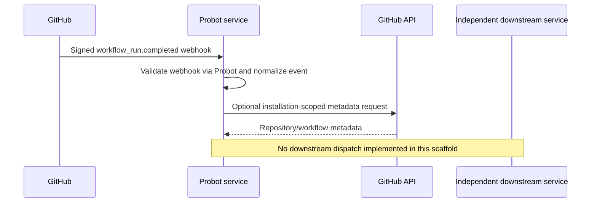

# Architecture

This repository contains only the GitHub App's integration code. GitHub owns App registration and installations; Probot receives signed webhook requests and supplies an installation-scoped Octokit client. Events are normalized into generic envelopes for future adapters.

## Independence

No signing credentials or Android build logic belongs in this repository. A future adapter must not treat webhook contents as permission to sign or publish. Downstream services verify their own authorization and artifact provenance.

## Delivery

Webhook reception requires a reachable HTTPS endpoint or a development relay. A self-hosted GitHub Actions runner polls GitHub over outbound connections but is a distinct execution model, not a webhook receiver.

## Testing boundaries

Unit tests cover normalization and filtering. They do not prove live GitHub App registration, webhook delivery, installation permissions, deployment, or multi-repo interoperability.
