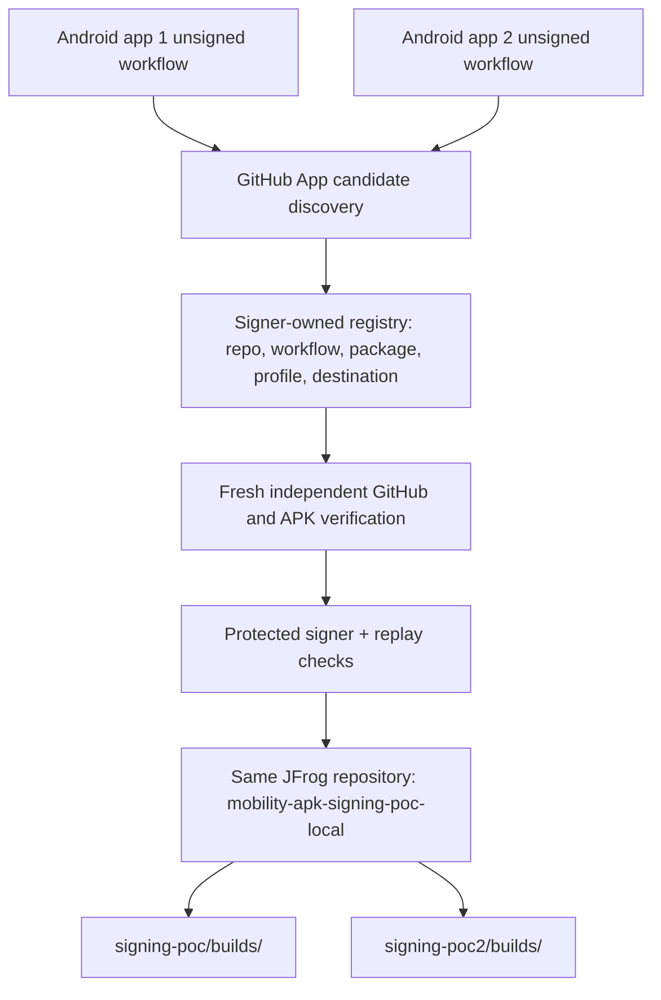

# Gabe / Device Availability — multi-application signing POC handoff

**As of 2026-11-01:** The original Android app has a real signed and uploaded APK verified against JFrog metadata and independent download. Both Android producers build unsigned APKs on Mac Studio self-hosted runners. App 2 passed read-only qualification and shared-repository/per-app-prefix policy checks, but **its real signing and publication have not happened**.

## What Gabe needed

Device Availability should own one GitHub App integration, one central signer with protected credentials, and **one existing JFrog repository** (`mobility-apk-signing-poc-local`) for multiple independently approved Android apps. App teams only deliver unsigned, provenance-verifiable GitHub Actions artifacts; they never receive the signing keystore, GitHub App PEM or JFrog token. The signer independently rechecks source identity before signing; candidate metadata is not permission to sign.

## Four repositories

- `erikg84/deivice-mobility-github-app`: read-only API-first discovery/descriptor; optional webhook/Probot. No signing authority.
- `erikg84/apk-signing-poc-app`: original unsigned APK producer, package `com.example.signingpoc`, repository ID `1437716718`, workflow ID `399993624`.
- `erikg84/mock-android-2`: second unsigned APK producer, package `com.example.signingpoc2`, repository ID `1441266259`, workflow ID `403067483`.
- `erikg84/mobility-apk-signing-service`: protected Python provenance/allowlist, signing, immutable-path publisher, ledger and verification. Owns policy.

## Proven evidence

**Original real publication:** GitHub run `40799940323`, artifact `12865143006`; unsigned APK SHA-256 `81ac155b3a8730780fc4eb607dc949f352cb55fb2f0558b19ec6374a35c347a7`; signed APK SHA-256 `edfb186a7c8c2802a50010432af9e65605f0b8684243b0eac2de2291606f1fa7`, certificate SHA-256 `41f8df4f4725c671f919cd180486d61b7d311169834e0d749df467dd724fdbcb`. Remote JFrog metadata and separately downloaded bytes matched. Historical reconciled publication receipt itself retained `readback_verified=false` because its receipt scope differed from the separate manual byte check.

**Second app build:** workflow run `41246196204` attempt 2 successful; further runner build `41322298601` successful. Real unsigned artifact and package were independently qualified earlier, but no live App 2 signing/Artifactory receipt is known.

**Multi-app code:** signer commit `28e40bb0486da89e134d5847a94ce3d9477c556c`, Mac Studio CI `41328209710` SUCCESS, 190/190 Python tests. Two apps use **same JFrog repository** with disjoint registry-enforced prefixes `signing-poc/` and `signing-poc2/`. App 2's publish activation is default-off; a signing identity and live protected-host step remain to be verified.

## Onboarding another Android application

Device Availability registers approved repository ID/name, workflow ID/path, package ID, signing profile/certificate policy and a unique destination prefix; grants least-privilege GitHub App repository read access; validates completed run and unsigned APK independently; signs through existing protected service; publishes into the **existing JFrog repository** under the assigned prefix; verifies remote checksum/bytes and logs non-secret receipts. No additional signing service or JFrog repository is required.

## Boundaries and remaining acceptance

An API-first candidate and successful CI run are not signing authorization. App 1 end-to-end is proven; App 2 is build/qualification/policy/test verified but live signing and publishing are NOT RUN. Automatic no-human webhook-to-sign flow, server-enforced atomic no-overwrite, cross-team ACLs, and device-install acceptance are productionization gaps. Do not describe them as completed.

**Canonical complete report and detailed acceptance matrix:** [Gabe / Device Availability POC handoff](https://github.com/erikg84/mobility-apk-signing-service/blob/main/docs/GABE_DEVICE_AVAILABILITY_POC_FINAL_HANDOFF.md).

